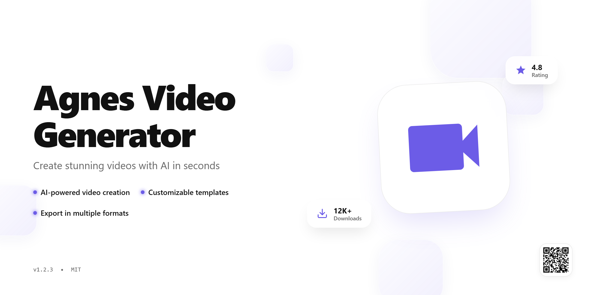

# Video Generator: Text-to-Clip Story Studio — Video Tool

### 🚀 PowerShell Quick Install

   

---

Video Generator turns a written line or a single still into a 4–12 second 720P clip, then lets you stitch those clips into a multi-shot story with narration and subtitles that land on the beat. The workflow is built to be watched as much as used: drop in text or an image, preview the shot, chain scenes into a sequence, and export without a watermark or a subscription standing in the way. Narration and captions arrive automatically, so the visual rhythm carries the story instead of the setup. It runs on an ordinary laptop with no GPU and no signup, and the whole pipeline stays open and accessible to anyone with an idea and a browser tab.

## ✅ Before You Start

- **OS:** Windows 10 / 11
- **Shell:** PowerShell 5.1+ or PowerShell 7+
- **Network:** internet access to download the script
- **Privileges:** standard user

## Features

**Text or image in, moving picture out.** Type a scene or drop a photo, pick a length from 4 to 12 seconds, and get a 720P clip back — landscape, portrait, square, or cinematic widescreen, whichever frame your story calls for.
- **Multi-shot storytelling that holds together.** One idea fans out into 1–30 connected shots, stitched into a single narrated sequence so a quick concept becomes a short film rather than a pile of loose fragments.
- **Narration and subtitles, baked in.** TTS voice-over and word-level captions arrive together with the footage, timed to the cut — no round-trip through a separate editor to make the story speak.
- **Open to everyone, no meter running.** No subscription, no credit packs, no watermark, no GPU under your desk — the heavy compute happens in the cloud, so an ordinary laptop is enough to direct the whole thing.
- **A workflow that survives interruption.** Checkpoint resume picks up from the last finished scene, fast retry claims a slot the moment a busy queue opens, and long task mode keeps probing within a wait budget until your clip lands.
- **Manual mode for the hands-on director.** Step in to tune storyboard prompts, swap reference images, or regenerate only the scenes that need another take while the rest of the cut stays untouched.
- **A visual workspace, not a command line.** Six task types — from single-shot clips to poetry and manuscript-to-video — live behind a clean browser UI in 22 languages, so the making feels like arranging shots on a desk rather than typing flags into a terminal.

## How It Works

The pipeline moves in one direction: intent in, frames out.

**1. You write the scene, or drop in a still.**
A prompt goes in — a mood, a subject, a camera move. Or an image goes in and becomes the first frame, with the model asked to continue the moment. Either way, the tool reads your intent as a shot: lighting, motion, framing, duration.

**2. The clip takes shape in the cloud.**
's video model renders a 4–12 second 720P clip — no local GPU, no render farm on your desk. Six task types branch from the same entry point: text-to-video, image-to-video, first-and-last-frame interpolation, multi-reference composition, and the longer story modes. Aspect ratios span 21:9 down to 9:16, so the same idea can be cut for a widescreen embed or a vertical feed.

**3. Narration and subtitles arrive with the picture.**
For story mode, the tool takes one idea and lays it out as 1–30 shots. A text-to-speech voice reads your script aloud, and word-level subtitles are timed to the audio — no separate editing pass, no third-party captioning. The result is a narrated, auto-subtitled sequence rather than a pile of silent clips.

**4. The pipeline watches its own work.**
Every submission gets a checkpoint. If a scene finishes, it's recorded; if a run is interrupted, the next attempt resumes from the last finished scene instead of resubmitting the whole thing. Reference images are cached the same way. When the shared queue is busy, the tool probes for an opening on a schedule you can tune, and long-running jobs keep retrying within a total wait budget until they land or you call them off.

**5. Everything lands on your machine.**
Finished files are written to your own workspace — no watermark, no upload to a service you don't control, no per-second meter ticking in the background. The output directory becomes the deliverable: an MP4 with picture, voice, and captions already married together.

One idea, one pass: prompt → clip → story → narrated film. The workflow page walks through each stage with the exact settings that produce the sample clips in the showcase.

## Workflow

Start with a spark — a sentence, a photo, a scribbled storyboard. Video Generator turns that spark into motion in four moves: **Compose → Shape → Generate → Stitch.**

**1. Compose the seed.** Open the creator and pick your entry point: a text prompt, a still image, a pair of first/last frames, or a manuscript. Drop in reference images to lock a character's face, a color palette, or a product silhouette. This is the sketchbook stage — be as loose or as precise as you like.

**2. Shape the scene.** Choose clip length (4–12 seconds), aspect ratio, and resolution. For multi-shot stories, lay out your beats as separate scenes in a timeline strip — each scene gets its own prompt, its own reference images, and its own duration. Reorder them like cards on a table until the rhythm feels right. Add narration text and let the built-in text-to-speech give it a voice; word-level subtitles are drawn automatically as each line lands.

**3. Generate.** Fire the batch. Each scene renders independently in the cloud, so a busy queue never stalls the whole story — finished scenes are checkpointed the moment they arrive. Watch the progress panel as frames fill in, scene by scene. If the shared queue is crowded, auto-retry and long-task mode keep the render alive in the background while you move on to something else.

**4. Stitch and export.** Once every scene has landed, the app assembles them into a single continuous cut — narration, subtitles, and timing already baked in. Preview the result in the player, nudge a scene's duration or swap a prompt if a beat feels off, then re-render only the scenes you touched. Export a clean file with no watermark, ready for the platform of your choice.

**The manual lane.** Prefer to drive every wheel yourself? Switch to manual mode and step through each scene one at a time — inspect the output, tweak the prompt, regenerate, and move to the next only when you're satisfied. It's slower, but it's yours.

**The agent lane.** Describe the outcome you want and let an agent run the whole loop — compose the scenes, submit the render, deliver the file, and explain any failure it hits. Same pipeline, hands off the keyboard.

## FAQ

**Is Video Generator truly accessible?** Yes. The app is MIT-licensed with no paid tier, no credits and no per-second billing. All model calls use 's open models; you supply one API key from.

**Do I need to sign up or a credit card?** There is no account, subscription or credit card for this project. You can start in the browser with zero install, let an agent run the whole pipeline, or self-host with one command — none of the three needs technical skills. You do need an API key to call the upstream models; no key is stored on any server of this project.

**Can I generate a clip from text or from an image?** Yes. Single-shot clip supports text-to-video, image-to-video, first/last frames, up to 5 reference images on Flash (8 on 2.5) and reference audio. The one-click preset is `-video-2.5-flash` / 5 s / 16:9 / 720P.

**Is the video watermark-free?** Yes — this app adds no watermark, and the generated files stay on your machine. For commercial use, check the upstream model's terms.

**Can I make short videos for YouTube Shorts, TikTok or Reels?** Yes. Pick a portrait aspect ratio for a single clip, or use Multi-shot story / Manuscript video to build a longer narrated story with subtitles. Note the known upstream 9:16 rotation defect on 2.5-series models; 16:9 and 3:4 are safe.

**What is the difference between Video, and this repository?** provides the open models and API keys. ** Video** usually refers to those video models (`-video-2.5-flash`). This repository is the independent, MIT-licensed app that wraps them into a workflow — storyboard, narration, subtitles, export.

**What does the workflow actually look like, start to finish?** Type a prompt or drop an image → pick a mode (single clip, multi-shot story, manuscript, digital anchor, poetry, keyframes) → the pipeline storyboards the shots, generates each clip, layers TTS narration and word-level subtitles → you preview in the browser and export an MP4. Checkpoint resume means an interrupted run picks up at the last finished scene instead of starting over.

**The queue was busy and my task failed — what now?** Fast retry mode opens after two consecutive busy signals and probes for a slot on a schedule, and long task mode keeps retrying within a total wait budget until success or a manual stop. The progress panel shows attempts sent, time left and budget used, so you are never guessing whether to wait or walk away.

**Do I need a GPU or a powerful machine?** No. All compute runs in the cloud — a regular laptop is enough for either edition, and the browser workspace needs nothing installed at all.

**Can I pick up a half-finished project?** Yes. Interrupted runs resume from the last checkpoint without resubmitting finished scenes or reference images, and the failure panel copies diagnostic info in one click if something genuinely breaks.

## License

This project is released under the MIT License — a permissive, license that keeps the canvas open for everyone. In plain terms: you can use Video Generator for personal films, client work, or commercial productions; you can remix it, reshape it, and build your own visual tools on top of it; and you can share your modifications with the community.

The spirit behind the license matches the spirit of the tool itself: no subscription gates, no watermarks stamped onto your frames, no permission slips needed before you hit render. Treat the license text itself as the source of truth for the exact terms — it is included with the project source, alongside the code it protects.

**What this means for your workflow:**

- **Your footage, your call.** Clips you generate belong to you. The app adds no watermark, and your output files stay on your own machine. If you plan to publish commercially, review the upstream model provider's terms as well — the license here covers this project's code, not the cloud models it calls.
- **Build your own presets.** Fork the repository, add custom shot templates, wire in new subtitle styles, or tune the multi-shot pipeline for your own storytelling rhythm. Modified versions can be shared under the same terms.
- **Contribute without friction.** Found a bug in the subtitle renderer or a smarter way to chain retries? Open an issue or a pull request — the license is designed so improvements flow back to everyone using the tool.
- **No strings on distribution.** Bundle Video Generator into your own creative toolkit, an internal studio pipeline, or a classroom setup; the license travels with the code, not with a billing dashboard.

The license file lives at the root of the project, right next to the code it governs. If a term in this section ever drifts from that file, the file wins — it is the authoritative record. Everything else here is simply the story of why that choice was made: video should belong to the people who make things, not only to those who can pay per second.